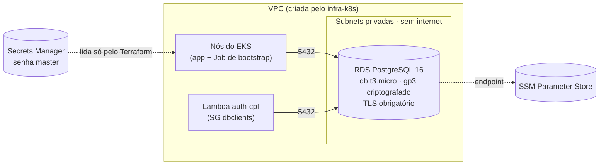

# postech-16soat-infra-db

Infraestrutura do banco de dados gerenciado do Tech Challenge (FIAP/SOAT, Grupo 15, Fase 3):
**Amazon RDS for PostgreSQL 16**, em subnets privadas, com um database e usuários próprios
para cada ambiente (`homolog` e `prod`), provisionado com Terraform.

Faz parte de um conjunto de quatro repositórios:

| Repositório | Papel |
|---|---|
| [postech-16soat-infra-k8s](https://github.com/daniellrsouza/postech-16soat-infra-k8s) | Rede, EKS, ECR, NLB, API Gateway |
| [postech-16soat-infra-db](https://github.com/daniellrsouza/postech-16soat-infra-db) (este) | Banco gerenciado (RDS PostgreSQL) |
| [postech-16soat-lambda](https://github.com/daniellrsouza/postech-16soat-lambda) | Autenticação por CPF (Lambda + authorizer) e rotas do gateway |
| [postech-16soat-app](https://github.com/daniellrsouza/postech-16soat-app) | Aplicação Spring Boot no EKS e documentação de arquitetura (`docs/`) |

Ordem de provisionamento: **infra-k8s → infra-db → lambda → app**. A justificativa da escolha do
banco, o diagrama ER e os ajustes no modelo relacional ficam em `docs/` do repositório da aplicação.

## Arquitetura deste repositório



Dentro da instância:

| Ambiente | Database | Usuário da aplicação | Usuário da Lambda |
|---|---|---|---|
| homolog | `tech_challenge_homolog` | `app_homolog` (dono do schema, usado pelo Flyway) | `lambda_homolog` |
| prod | `tech_challenge_prod` | `app_prod` | `lambda_prod` |

- Os usuários da Lambda pertencem ao papel `leitura_clientes`. A migration da aplicação concede a
  esse papel apenas `SELECT` em `clientes`, para consultar a existência e o status do cliente.
- Cada usuário só tem `CONNECT` no database do próprio ambiente (o `CONNECT` público é revogado
  nos databases dos ambientes e no database inicial `postgres_admin`): homolog não alcança os dados
  de prod.

Verificado em homolog com um pod temporário usando as credenciais geradas:

| Teste | Resultado |
|---|---|
| `lambda_homolog` conecta em `tech_challenge_homolog` | ok |
| `lambda_homolog` cria tabela | negado (`permission denied for schema public`) |
| `lambda_homolog` / `app_homolog` conectam em `postgres_admin` | negado |
| `app_homolog` cria e remove tabela (dono do schema) | ok |
| Conexão sem TLS | negada (`no encryption`) |
- A senha master é gerada e guardada pelo próprio RDS no Secrets Manager
  (`manage_master_user_password`) e só é usada pelo Job de bootstrap.
- O runner do GitHub não alcança o RDS privado. Por isso, o database e os usuários são criados por
  um **Job no cluster EKS** (`postgres:16-alpine` + `psql`), idempotente, que o Terraform executa e
  aguarda.

## Estrutura

```
stacks/
  shared/   RDS, subnet group, parameter group, security groups
  env/      por ambiente: segredos, Job de bootstrap (database, usuários, permissões)
scripts/
  tf.sh     init com o backend da conta + plan/apply/destroy de um stack
.github/workflows/terraform.yml
```

### Contrato com os outros repositórios (SSM Parameter Store)

| Parâmetro | Tipo |
|---|---|
| `/tech-challenge/shared/db-host`, `db-port`, `db-clients-sg-id`, `db-master-secret-arn` | String |
| `/tech-challenge/<env>/db-name`, `db-app-user`, `db-lambda-user` | String |
| `/tech-challenge/<env>/db-app-password`, `db-lambda-password`, `jwt-secret` | **SecureString** |

O `jwt-secret` de cada ambiente é gerado aqui e usado pela Lambda (emissão e validação do token) e
pela aplicação (validação), garantindo o mesmo valor nos dois lados.

## Tecnologias

Terraform 1.15 · AWS provider 6 · Kubernetes provider 2 · Random provider 3 ·
Amazon RDS for PostgreSQL 16 · AWS Secrets Manager · SSM Parameter Store · GitHub Actions.

## Execução local

Pré-requisitos: Terraform ≥ 1.15, AWS CLI com as credenciais da sessão do AWS Academy, Bash, e o
`infra-k8s` já aplicado (este repositório lê a VPC e o cluster no SSM).

```bash
scripts/tf.sh shared apply
scripts/tf.sh env homolog apply
scripts/tf.sh env prod apply
```

Para destruir: `scripts/tf.sh env homolog destroy`, `scripts/tf.sh env prod destroy` e
`scripts/tf.sh shared destroy`. A instância não tem proteção contra exclusão nem snapshot final,
por ser ambiente de laboratório.

## Deploy (CI/CD)

`.github/workflows/terraform.yml`:

| Evento | O que roda |
|---|---|
| PR para `develop` ou `main` | `fmt`, `validate`, `plan` do shared e do ambiente de destino |
| push na `develop` | `apply` do ambiente **homolog** |
| push na `main` | `apply` do **shared** (RDS) e do ambiente **prod** |
| `workflow_dispatch` | `plan`/`apply`/`destroy` manual de `shared`, `homolog` ou `prod` |

A `main` é protegida e só recebe mudanças por Pull Request. Secrets: `AWS_ACCESS_KEY_ID`,
`AWS_SECRET_ACCESS_KEY` e `AWS_SESSION_TOKEN` (sessão do AWS Academy).

## Decisões e limitações

- **Single-AZ** (`db.t3.micro`): sem failover automático, por limite de orçamento do laboratório.
  Em produção real, o caminho é Multi-AZ, e só exige trocar `multi_az` e a classe da instância.
- Backup automático com retenção de 1 dia; logs do Postgres exportados para o CloudWatch, com
  registro das consultas acima de 500 ms.

## APIs

Este repositório não expõe APIs. Swagger e coleções Postman da aplicação estão no
[postech-16soat-app](https://github.com/daniellrsouza/postech-16soat-app).
